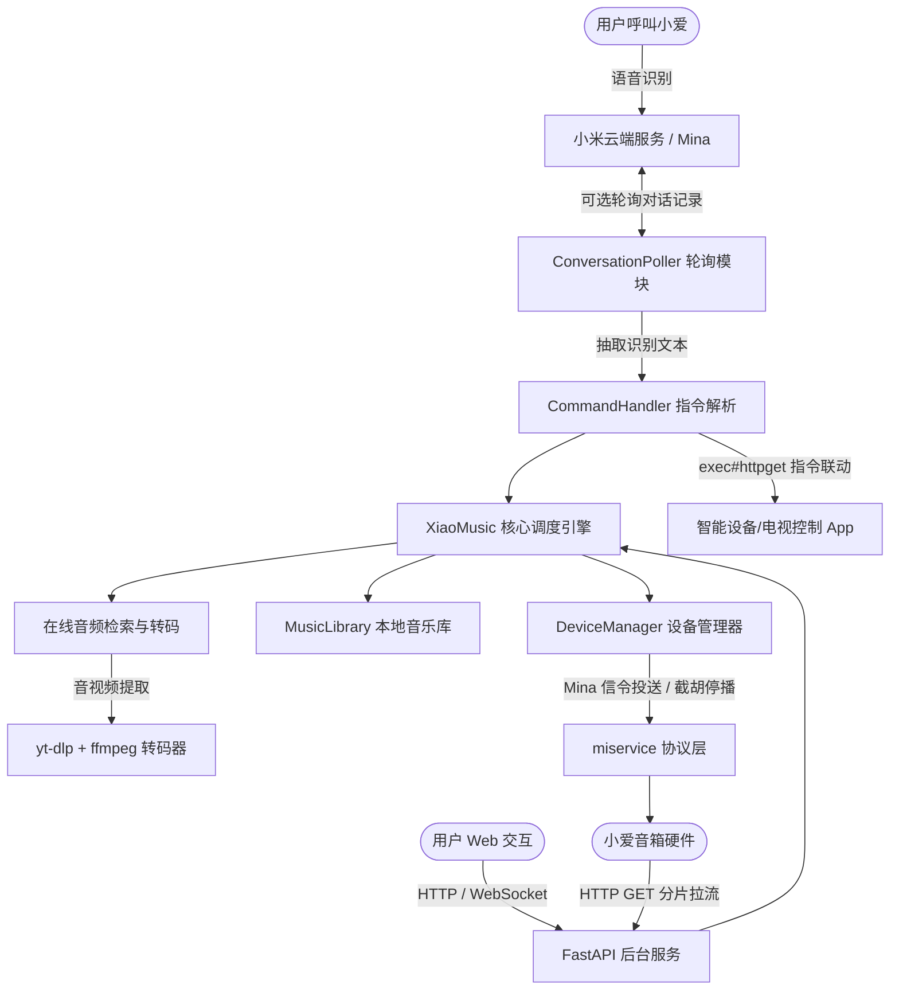

# XiaoMusic: 解放小爱音箱的智能音乐中枢

[](https://github.com/hanxi/xiaomusic)
[](https://hub.docker.com/r/hanxi/xiaomusic)
[](https://hub.docker.com/r/hanxi/xiaomusic)
[](https://www.python.org/)

---

<p align="center">
  <strong>🎵 打破版权限制，让小爱音箱自由播放本地高保真曲库与全网在线流媒体，打造智能家居语音联动控制中枢。</strong>
</p>

---

## 📖 项目定位与核心特性

**XiaoMusic** 是一个为小米小爱智能音箱打造的私有化音频串流与语音控制服务器。打破官方曲库与版权限制，支持将本地无损音乐、网络流媒体以及智能家居外设通过小爱音箱进行语音点播与控制。

- **自由流媒体**：通过 `yt-dlp`、`ffmpeg` 抓取并转码全网音视频，支持本地无损歌曲（MP3, FLAC, WAV, APE）智能解析与串流。
- **纯净隐私（已优化）**：彻底移除了所有第三方遥测统计（Sentry/Glitchtip、Google Analytics、Umami），关闭所有多余的外链提示，零隐私外泄，纯本地无感运行。
- **即点即播（HTTP 206）**：采用分片传输协议，音箱接收指令后边下边播，无需漫长等待整首歌曲下载。
- **自定义语音命令**：内置强大的命令匹配系统，支持通过 `exec#httpget` 联动局域网任意智能设备（如电视、电脑、IoT 网关）。
- **极轻量跨平台**：支持运行在 Docker、Linux、Windows、Mac，甚至可直接在 **旧 Android 手机（Termux）** 上原生免容器超低功耗常驻。

---

## 🏗️ 系统架构与数据流图



---

## 🔍 核心机制深度解析

### 1. 音频投送机制（信令控制与主动拉流分离）
小爱音箱**不接受外部主动推流（Push）**，XiaoMusic 采用 **“云端信令调度 + 音箱主动拉流（Pull）”** 架构：
1. **地址生成**：服务端将本地文件或网络流映射为局域网直链（如 `http://<IP>:58090/music/<歌名>.mp3`）；
2. **信令下发**：通过小米 Mina 协议向音箱下发 `play_by_url` 信令；针对部分限制固件，系统会自动伪装合规的曲库 `audio_id` 绕过官方拦截；
3. **分片拉流**：音箱硬件收到 URL 后，主动向 XiaoMusic 发送支持 `Range: bytes=` 的 HTTP GET 请求，XiaoMusic 以 `HTTP 206 Partial Content` 流式响应，音箱秒级解码播放。

### 2. 对话拦截与打断抢占（Force Stop）
当用户语音点播时，小米官方云端会优先响应。XiaoMusic 通过毫秒级信令抢占完成替换：
1. 识别到匹配指令时，立即向音箱连续发送 `player_pause` 与 `player_stop` 信令掐断官方播报；
2. 紧接着下发 XiaoMusic 音频流，直接抢占音箱音频通道；
3. **技巧**：配合米家 App“小爱训练计划”，将常用指令设定为“静默/空动作”，可在源头上完全消除小爱多余的回复插嘴。

### 3. 对话轮询监听机制（避免风控）
- **默认状态**：配置项 `"enable_pull_ask": false`，**默认不主动轮询小米云端**，不产生多余网络请求。
- **开启入口**：进入设置页 -> 点击展开【⚠️ 以下为高级配置】 -> 切换至【设备对话】Tab -> 将 **“获取对话记录”** 设为 `true`。
- **保护策略**：
  - 基于全局单一会话长连接复用，避免频繁 TCP/SSL 握手；
  - 维护时间戳栅栏（`last_timestamp`），杜绝重复响应历史记录；
  - 遇到 401 或登录异常时自动触发 **60 秒冷却自愈锁**，杜绝高频重试导致的账号风控。

### 4. 账号登录与授权本质
- **为什么不出现在小米第三方授权列表**？  
  XiaoMusic 并不是向小米开放平台申请 OAuth 2.0 授权的第三方 App（小米官方未开放小爱音箱控制 API），而是模拟米家客户端（`sid=mijia` / `sid=micoapi`）的原生登录。
- **安全查验**：登录记录会作为新的设备会话记录在小米账号安全中心的 **【登录设备管理】** 中；凭证仅保存在本地 `conf/auth.json` 与 `conf/.mi.token`。随时可以在设备管理中踢出或更改密码使凭证失效。

---

## 🚀 部署指南

### 方案 A：Docker 快速部署（推荐用于 NAS / 服务器）

#### 1. Docker Compose
创建 `docker-compose.yml`：
```yaml
services:
  xiaomusic:
    image: hanxi/xiaomusic
    container_name: xiaomusic
    restart: always
    ports:
      - 58090:8090
    volumes:
      - ./music:/app/music
      - ./conf:/app/conf
```

#### 2. 常用 Docker CLI
```bash
docker run -d \
  --name xiaomusic \
  --restart always \
  -p 58090:8090 \
  -v $(pwd)/music:/app/music \
  -v $(pwd)/conf:/app/conf \
  hanxi/xiaomusic
```

---

### 方案 B：本地 Python 源码与虚拟环境运行（适合 Windows / macOS / Linux）

#### 1. 系统底层依赖
- **Python 3.10+**（推荐 Python 3.11 或 3.12）
- **FFmpeg / FFprobe**（需安装并加入系统 PATH，或在启动参数中显式指定 `--ffmpeg_location`）

#### 2. 创建并配置虚拟环境
推荐为 XiaoMusic 建立专用的虚拟环境，实现与全局 Python 隔离：

```bash
# 1. 克隆代码
git clone https://github.com/hanxi/xiaomusic.git
cd xiaomusic

# 2. 创建虚拟环境 (二选一)
# 方式 A：使用标准 Python 自带 venv
python -m venv .venv

# 方式 B：使用现代化极速包管理工具 uv (推荐，秒级建环)
# uv venv .venv
```

#### 3. 安装项目依赖
```bash
# Windows PowerShell 激活虚拟环境
.venv\Scripts\Activate.ps1
# (若提示脚本被禁止运行，可先执行: Set-ExecutionPolicy -Scope Process -ExecutionPolicy Bypass)

# Linux / macOS 激活虚拟环境
# source .venv/bin/activate

# 安装完整项目依赖
pip install -e .
# 或使用 uv: uv pip install -e .
```

#### 4. 在虚拟环境下启动服务

##### 💡 启动方式 1：直接调用虚拟环境解释器（推荐开机自启、批处理或守护进程）
无需先激活环境，直接指定虚拟环境内的 Python 执行文件，最稳健防错：
- **Windows (PowerShell / CMD)**：
  ```powershell
  .venv\Scripts\python.exe -m xiaomusic.cli --port 58090 --ffmpeg_location "C:\app\ffmpeg\bin"
  ```
- **Linux / macOS**：
  ```bash
  ./.venv/bin/python -m xiaomusic.cli --port 58090
  ```

##### 💡 启动方式 2：在已激活的虚拟环境中运行
- **Windows**：
  ```powershell
  .venv\Scripts\Activate.ps1
  python -m xiaomusic.cli --port 58090 --ffmpeg_location "C:\app\ffmpeg\bin"
  ```
- **Linux / macOS**：
  ```bash
  source .venv/bin/activate
  python -m xiaomusic.cli --port 58090
  ```

---

### 方案 C：旧手机全能微服务器（小米 10 + Termux 原生极简部署）

利用闲置 Android 手机（如小米 10，骁龙 865），无需 PC/NAS，打造常驻 24 小时低功耗中枢（1~2W 待机，自带电池充当 UPS 防断电）：

1. **Termux 环境准备**：
   ```bash
   pkg update
   pkg install python nodejs-lts ffmpeg git
   ```
2. **克隆与安装**：
   ```bash
   git clone https://github.com/hanxi/xiaomusic.git
   cd xiaomusic
   pip install -e .
   ```
3. **后台保活与启动**：
   ```bash
   # 获取常驻唤醒锁（防止系统休眠）
   termux-wake-lock
   
   # 启动服务
   python -m xiaomusic.cli --port 58090
   ```
4. **系统设置**：在 Android 系统中将 Termux 和相关 App 的“省电策略”设为 **“无限制”** 并允许自启动。

---

## 📺 进阶扩展：智能家居外设联动（控制电视/空调）

### 场景痛点
小爱音箱（如 LX06）硬件设计为蓝牙主机（Central）或音频接收端（A2DP），无法作为蓝牙键盘从机（HID Peripheral）连接电视，强行改造会导致驱动崩溃。

### 最佳架构闭环
利用部署了 XiaoMusic 的常驻手机（如小米 10）同时运行电视控制 App，并利用 XiaoMusic 的 `exec#httpget` 机制实现 **0ms 内部回环直连**：

```text
[用户语音: "打开电视"] ──> 【小爱音箱】 ──> 【XiaoMusic 服务端】
                                                     │
                                       (命中自定义口令: exec#httpget)
                                                     │
                                                     ▼
【电视机】 <── [蓝牙/红外] <── 【小米10 本地电视控制服务 (127.0.0.1:8088)】
```

### 口令字典配置
在 `conf/setting.json` 或 Web 界面的“自定义口令”中加入：
```json
{
  "user_key_word_dict": {
    "打开电视": "exec#httpget(\"http://127.0.0.1:8088/tv/power\")",
    "关闭电视": "exec#httpget(\"http://127.0.0.1:8088/tv/power\")",
    "电视静音": "exec#httpget(\"http://127.0.0.1:8088/tv/mute\")",
    "电视换台": "exec#httpget(\"http://127.0.0.1:8088/tv/channel_next\")"
  }
}
```

---

## ⚡ 极速进阶：open-xiaoai 本地直传构想（100ms 极低延迟）

针对已 Root 的小爱音箱（如 LX06），可在音箱内部通过 `open-xiaoai` 监听 `/tmp` 目录下的 ASR 识别日志，通过局域网 Webhook 秒推至 XiaoMusic：
1. **0 延迟响应**：将响应延迟从 1~2 秒压缩至 100~200ms；
2. **彻底免风控**：完全关闭云端轮询协程；
3. **硬件级静音**：音箱在本地收到指令的第 0 毫秒即可直接挂起自带 TTS 进程，彻底消灭官方多余回复。

---

## ⚙️ 核心配置参数表

| 配置项 | 默认值 | 作用说明 |
| :--- | :--- | :--- |
| `port` / `public_port` | `58090` | Web 界面与音频直链拉流端口 |
| `hostname` | `http://127.0.0.1` | 服务所在主机的局域网 IP（必须小爱音箱能访问到） |
| `music_path` | `music` | 本地音频文件存放主目录 |
| `download_path` | `music/download` | 网络点播抓取后的转码音频存放目录 |
| `enable_pull_ask` | `false` | 是否开启云端对话轮询（高级配置中开启） |
| `pull_ask_sec` | `1` | 对话轮询频率（单位：秒） |
| `ffmpeg_location` | 自动检测 | FFmpeg 与 FFprobe 可执行文件所在路径 |
| `search_prefix` | `bilisearch:` | 默认歌曲搜索引擎（支持 `bilisearch:`, `ytsearch:` 等） |

---

## ❓ 常见问题答疑 (FAQ)

### Q1: 扫码登录后，系统现在是不是每秒都在向小米拉取语音日志？
**不会。**
- 系统默认配置中 `"enable_pull_ask": false`，轮询模块处于静默休眠状态，后台完全不会向小米云端发起检索请求。
- 只有你在后台手动将“获取对话记录”开启后，系统才会按照设定的秒数（默认 1 秒）进行轮询。未开启前仅处理网页端点播和本地音乐管理。

### Q2: 为什么在设置界面中没看到“监听语音控制”的开关？
**因为该配置被归类在高级折叠选项中，且名称为“获取对话记录”。**
- **查找路径**：访问设置页（`http://localhost:58090/static/default/setting.html`） ➔ 往下滑动并点击展开 **`⚠️ 以下为高级配置，请谨慎修改...`** ➔ 点击 **【设备对话】** Tab。
- 在此处即可看到 **“获取对话记录”**（对应配置项 `enable_pull_ask`，默认值为 `false`）及轮询间隔秒数。

### Q3: 扫码登录后，我的小米账号“第三方授权应用列表”里为什么找不到 XiaoMusic？
**这是完全正常的底层设计。**
- 截图或安全中心看到的“第三方授权列表”是基于开放平台标准 OAuth 2.0 协议的应用（如搜狗输入法、腾讯加速器等）。
- 由于小米官方从未对外开放音箱的直链播放和对话控制接口，XiaoMusic 是通过模拟**小米官方原生客户端（`sid=mijia` / `sid=micoapi`）**的方式实现登录。在小米云端眼中，这是一次合法的官方客户端登录会话。
- **查看与撤销路径**：进入小米账号安全中心 ➔ **【登录与安全】** ➔ **【登录设备管理】**，你会看到一条新的设备/网页登录记录；随时可以在该处踢出或通过修改小米密码强制使本地 Token 失效。

### Q4: 项目中是否存在未知上报或泄露 Token 的有害代码？
**已全面审计并彻底清除。**
- 原版代码中包含用于收集崩溃日志的 Sentry (Glitchtip) 以及用于网页访问统计的 Google Analytics (GA4) 和 Umami。
- 在当前版本中，已将所有的外部上报网络请求彻底删除或重写为本地无害的空操作（No-Op），网页模板中的跟踪代码与外部停更引流横幅也已彻底清理，杜绝任何敏感凭证与硬件 Token 外泄。

### Q5: 小爱音箱 Pro (LX06) 可以直接作为蓝牙键盘连接电视控制开关与换台吗？
**无法直接实现。**
- 电视连接外部键盘需要音箱扮演 **Bluetooth HID Peripheral（从机模式）**。
- 小爱音箱 LX06 硬件出厂架构为蓝牙网关主机（Central）或音频接收端（A2DP Sink），Linux 系统底层未包含 HID 从机协议栈，强行通过 BlueZ 虚拟从机会导致 WiFi/蓝牙共存固件崩溃或死锁。
- **更优方案**：使用本身已通过蓝牙连接电视的常驻设备（如备用手机、ESP32），由其作为桥梁响应指令。

### Q6: 已经用旧手机（如小米 10）连接电视并开发了控制 App，怎样让小爱音箱联动？
**只需让该 App 暴露轻量 HTTP 服务，结合 XiaoMusic 自定义口令即可。**
1. 电视控制 App 在局域网内开启一个简易 HTTP 接口（例如控制电源为 `GET http://127.0.0.1:8088/tv/power`）；
2. 在 XiaoMusic 的自定义口令字典（`user_key_word_dict`）中绑定该指令：
   ```json
   "打开电视": "exec#httpget(\"http://127.0.0.1:8088/tv/power\")"
   ```
3. 对音箱呼叫“小爱同学，打开电视”，XiaoMusic 截获口令后即刻在后台执行 HTTP 请求，实现电视秒级开机。

### Q7: 可以将 XiaoMusic 用 Docker 部署到手机的 Termux 上吗？
**完全可以，但强烈推荐在 Termux 中“原生运行”，无需 Docker。**
- 大多数 Android 内核未编译完整的 `cgroups` 与命名空间，在手机上运行 Docker 容器需要解锁并重新刷入定制内核，门槛高且不稳定。
- **Termux 原生环境极度轻量**：Termux 官方源原生提供了 `python 3.12`、`nodejs-lts` 与 `ffmpeg`。直接通过 `pip install -e .` 运行，整机运行内存仅占约 **150MB**，待机功耗仅 **1~2W**，配合手机内置电池还能充当天然 UPS，断电也能稳定运行。

### Q8: 如果音箱已经 Root 并刷了 open-xiaoai，是不是可以直接本地获取语音指令？
**是的，这是最完美的终极架构方案。**
- 结合 `open-xiaoai`，音箱可以在本地利用 `inotify` 实时监听识别文本文件，一旦收到点播或智能家居指令，直接通过局域网内网 Webhook 毫秒级推给 XiaoMusic 服务端；
- **两大突破**：
  1. **彻底关闭云端轮询**：告别高频请求，云端风控率直降为 0%；
  2. **毫秒级极速切歌**：将语音指令的响应延迟从 1~2 秒极限压缩到 **100~200ms**，并在第 0 毫秒硬件级掐断官方原声插嘴。

---

## 📄 开源许可

本项目依据 [MIT License](LICENSE) 开源发布。
