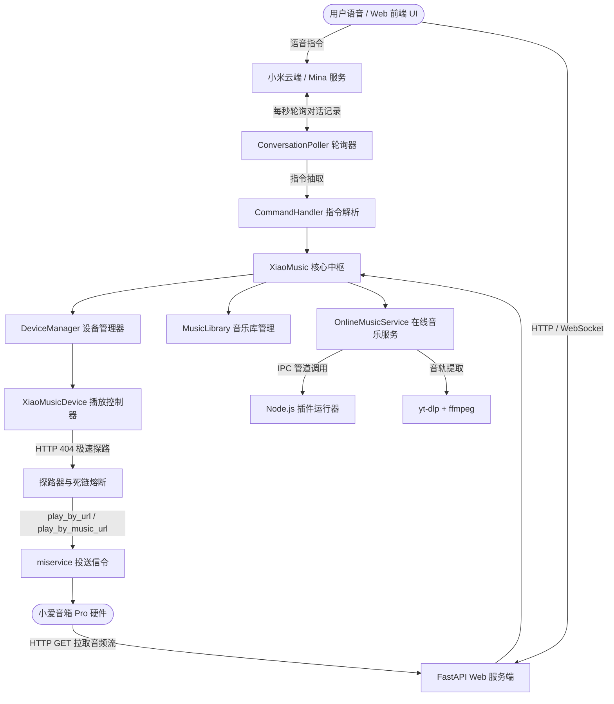
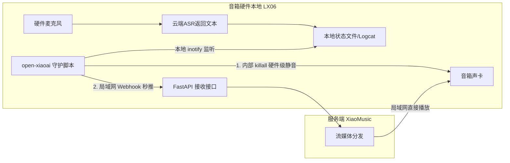

# XiaoMusic 项目调研与技术架构全景分析报告

> 归档时间：2026-10-28  
> 测试环境：Windows 11 / Python 3.12 (uv 虚拟环境) / FFmpeg 8.x / 小爱音箱 Pro (LX06)

---

## 一、 项目背景与概述

[XiaoMusic](https://github.com/hanxi/xiaomusic) 是一个开源的小爱智能音箱伴侣服务，主要目标是**打破小爱音箱的官方版权和播放源限制**，使用户能够通过小爱音箱自由播放本地高保真音乐库、网络电台，并通过第三方插件生态聚合全网在线音乐资源。

- **核心定位**：小爱音箱音频串流控制中枢 & 本地/在线音乐服务器
- **开发语言与栈**：Python 3.10+ (FastAPI, Uvicorn, asyncio, aiohttp) + Node.js (用于执行 MusicFree 规范的 JS 音源插件)
- **底层依赖**：
  - `miservice-fork`：小米云端 API / Mina 协议 / MiIO 局域网协议
  - `yt-dlp`：音视频下载与解析提取
  - `ffmpeg` / `ffprobe`：音频流提取、格式转码与元数据解析
  - `mutagen`：本地音频 ID3 标签、时长与封面解析
  - `edge-tts`：高质量微软语音合成服务

---

## 二、 系统架构与分层设计



---

## 三、 核心工作机制深度解析

### 1. 音频投送机制（信令控制与流式数据通道分离）
小爱音箱并不接受外部服务直接向其推流（Push），而是采用 **“服务端下发指令（信令） + 音箱主动拉流（Pull）”** 的工作模式：
1. **音频地址生成**：
   - **本地音乐**：映射为局域网静态直链：`http://<局域网IP>:58090/music/<歌曲名>.mp3`；
   - **在线/插件音乐**：映射为代理接口：`http://<局域网IP>:58090/api/proxy/plugin-url?data=<base64>`。
2. **云端信令下发**：
   - 常规机型：调用 `mina_service.play_by_url(device_id, url)`；
   - 限制/锁固件机型：调用 `mina_service.play_by_music_url(device_id, url, audio_id)`，先向小米官方曲库搜索一个真实存在的合规 `audio_id`，带着该 ID 下发自定义流，实现免拦截播放。
3. **分片拉流与在线秒播**：
   - 音箱接收到 URL 后，主动向 XiaoMusic 发送 HTTP GET 请求；
   - 服务端支持 `HTTP 206 Partial Content` 分片传输，音箱边下载边流式解码播放，**无需等待整首下载**。

---

### 2. 对话拦截与打断机制（Force Stop）
当用户对音箱发出指令时，小米云端原声会先响应（例如“抱歉，没有找到这首歌”）。XiaoMusic 通过信令抢占完成截胡：
1. **优先强制终止**：在 `command_handler.py` 匹配到有效指令后，第一时间调用 `device.group_force_stop_xiaoai()`；
2. **下发终止包**：底层通过 Mina 协议连续下发 `player_pause` 和 `player_stop`，将音箱正在播报的语音或自带音乐强行掐断；
3. **占领音频通道**：紧接着下发 XiaoMusic 自己的音频链接，替换音箱内置的解码播放流；
4. **终极无声技巧**：配合米家 App“小爱训练计划”，将常用唤醒短语设定为“静音/空动作”，可在源头上彻底消除小爱官方插嘴。

---

### 3. 轮询监听机制（高频生产者-消费者管道）
- **运作逻辑**：基于 Python `asyncio` 异步协程，后台以 1 秒为节拍（由 `pull_ask_sec` 控制）向小米官方接口发送轻量 HTTP 同步请求；
- **双事件协同**：通过 `new_record_event` 唤醒消费逻辑，处理期间使用 `polling_event.clear()` 暂停轮询，防止处理耗时引起指令重复触发；
- **时间戳栅栏**：维护设备维度的 `last_timestamp[did]`，仅处理 `timestamp > last_timestamp` 的全新记录，过滤所有历史消息；
- **防风控与自愈保护**：
  - 复用全局唯一的 `aiohttp.ClientSession` 长连接，不产生频繁的三次握手/SSL 握手；
  - 遇到 401 / 70016 等鉴权异常时，强制触发 **60 秒冷却保护锁（`REINIT_COOLDOWN_SEC = 60`）**，绝不进行盲目高频重试。

---

### 4. 连续播放与预缓存调度（Prefetch）
由于小爱音箱不提供“播放完成”的回调事件，XiaoMusic 采用时间预测机制：
1. **音频时长测量**：本地文件由 `mutagen` 解析，网络音频通过接口或部分下载测定时长；
2. **内存计时器**：在服务端建立 `asyncio.sleep(sec)` 异步定时器；
3. **后台预加载**：当前歌曲播放满 20 秒且剩余时长充足时，后台静默启动 `prefetch_next_song`，提前将下一首歌曲缓存至磁盘；
4. **状态保持洗牌 (Stateful Shuffle)**：随机模式下列表生成后永久保持，当前曲目洗牌置顶，避免随机切歌时造成死循环。

---

## 四、 本地实测记录

### 1. 歌曲抓取与转码实测（洛天依 投食歌）
- **搜索源**：`bilisearch1:洛天依 投食歌` (Bilibili 搜索)
- **命中文档**：《洛天依投食歌》原版PV“好饿好饿好饿，我真的好饿”（BV号：`BV1LuCtYXEgZ`，UP主：栣机）
- **抓取结果**：
  - 音频流原始大小：`2.85 MiB` (格式 ID: 30280，下载速率 5.16 MB/s)
  - 转码工具：`C:\app\ffmpeg\bin\ffmpeg.exe`
  - 最终文件：`music/download/洛天依 投食歌.mp3`
- **FFprobe 音质检测**：
  - 格式：`MPEG Audio Layer 3 (MP3)`
  - 采样率：`44100 Hz`
  - 声道：`2 (立体声)`
  - 比特率：`232.7 kbps`
  - 时长：`167.32 秒` (2 分 47 秒)

### 2. 环境部署与服务联调
- **依赖管理**：通过 `uv venv .venv` 创建 Python 3.12 虚拟环境，并使用 `uv pip install -e .` 安装 57 项完整依赖；
- **服务运行**：在后台成功作为守护进程监听 `http://localhost:58090`；
- **小米设备登录与发现**：
  - 扫码授权成功，凭证已安全保存至 `conf/auth.json` 与 `conf/.mi.token`；
  - 成功检索到在线音箱硬件：
    - **设备名称**：小爱音箱 Pro
    - **硬件型号**：`LX06`
    - **设 备 ID**：`862712416`
    - **在线状态**：`online`
    - **固件版本**：`1.94.13`
    - **局域网适配 IP**：`http://192.168.1.175:58090`

---

## 五、 终极演进构想：结合 open-xiaoai 改造 LX06（本地直传架构）

针对现有“云端每秒轮询”在极端场景下潜在的风控与 1~2 秒延迟痛点，结合已 Root 的 LX06 硬件，可进行纯本地事件驱动改造：



### 1. 结合后的核心收益
1. **响应延迟压缩至 100~200ms**：不再等待 1 秒轮询周期，音箱本地监听到解析结果立刻通过局域网 Webhook 推送，实现真正的瞬时切歌；
2. **0% 云端风控率**：彻底停用后台持续的云端对话轮询（关闭 `ConversationPoller`）；
3. **彻底杜绝官方小爱插嘴**：无需等待外部信令掐断，音箱内部脚本在收到文本的第 0 毫秒即可直接挂起自带 TTS 播放器。

### 2. XiaoMusic 服务端轻量改造
在 FastAPI 中只需增加极简的接收端点：
```python
@router.post("/api/voice_command")
async def receive_voice_command(data: dict):
    """接收音箱本地抓取的实时语音指令"""
    query = data.get("query")
    did = data.get("did", default_did)
    await xiaomusic.command_handler.do_check_cmd(did=did, query=query, ctrl_panel=False)
    return {"status": "ok"}
```

---

## 六、 智能家居外设联动：小米 10 电视控制闭环

### 1. 为什么不采用“音箱模拟蓝牙键盘”？
- **角色冲突与兼容性差**：电视连接外置键盘需要对方作为 **Bluetooth HID Peripheral（从机模式）**。LX06 的蓝牙模块出厂设计为网关主机（Central）或音频接收端（A2DP Sink），在嵌入式 Linux 上通过 BlueZ 打补丁虚拟 HID 极易导致 WiFi/蓝牙共存固件崩溃；
- **最佳解法**：充分复用现有已经连接电视的小米 10 手机，作为专门的“电视控制网关”。

### 2. 系统闭环设计
```text
[用户语音: "打开电视"] ──> 【LX06 音箱】 ──> 【XiaoMusic 中枢】
                                                    │
                                     (命中自定义口令: exec#httpget)
                                                    │
                                                    ▼
【电视机 (开关/换台)】 <── [蓝牙/红外] <── 【小米 10 (内网 App 监听 :8088)】
```

### 3. XiaoMusic 口令字典无侵入对接
利用 XiaoMusic 内置的 `exec#httpget` 机制，在配置中直接绑定：
```json
{
  "打开电视": "exec#httpget(\"http://127.0.0.1:8088/tv/power\")",
  "关闭电视": "exec#httpget(\"http://127.0.0.1:8088/tv/power\")",
  "电视静音": "exec#httpget(\"http://127.0.0.1:8088/tv/mute\")",
  "电视换台": "exec#httpget(\"http://127.0.0.1:8088/tv/channel_next\")"
}
```

---

## 七、 终极一体化落地：小米 10 + Termux 打造全能微服务器

将**电视控制 App** 与 **XiaoMusic 音乐服务** 全部部署在常驻供电的小米 10 上，无需单独开启 NAS 或 PC 电脑。

```text
┌─────────────────────────── 小米 10 手机 ───────────────────────────┐
│                                                                    │
│  【电视控制 App】: 监听本机 127.0.0.1:8088                          │
│           ▲                                                        │
│           │ 本机 Loopback 环回通信 (0ms 延迟)                       │
│           ▼                                                        │
│  【XiaoMusic 服务端 (Termux)】: 监听局域网 :58090                   │
│                                                                    │
└────────────▲───────────────────────────────────────┬───────────────┘
             │                                       │
     语音指令分发/下发播歌                          发送蓝牙/红外指令
             │                                       │
             ▼                                       ▼
    【小爱音箱 Pro (LX06)】                             【电视机】
```

### 1. 部署建议：Termux 原生运行（优于 Docker）
- Android 官方内核通常未编译完整的 `cgroups`，在手机上跑 Docker 容器通常需要定制内核；
- **Termux 原生环境极简且高效**：Termux 官方源直接提供 `python 3.12`, `nodejs-lts`, `ffmpeg` 原生支持；
- 资源占用极低（仅占 ~150MB 内存），骁龙 865 芯片待机功耗仅 1~2W，自带电池充当不间断电源（UPS）。

### 2. 部署指令清单
```bash
# 安装基础运行栈
pkg update
pkg install python nodejs-lts ffmpeg git

# 克隆并运行 XiaoMusic
git clone https://github.com/hanxi/xiaomusic.git
cd xiaomusic
pip install -e .
python -m xiaomusic.cli --port 58090
```

### 3. 后台保活核心配置
1. **防止 CPU 深度睡眠**：在 Termux 终端执行 `termux-wake-lock` 获取常驻唤醒锁；
2. **电源优化豁免**：在系统设置中将 **Termux** 与 **电视控制 App** 的“省电策略”全部设置为 **“无限制”** 并开启自启动权限。

